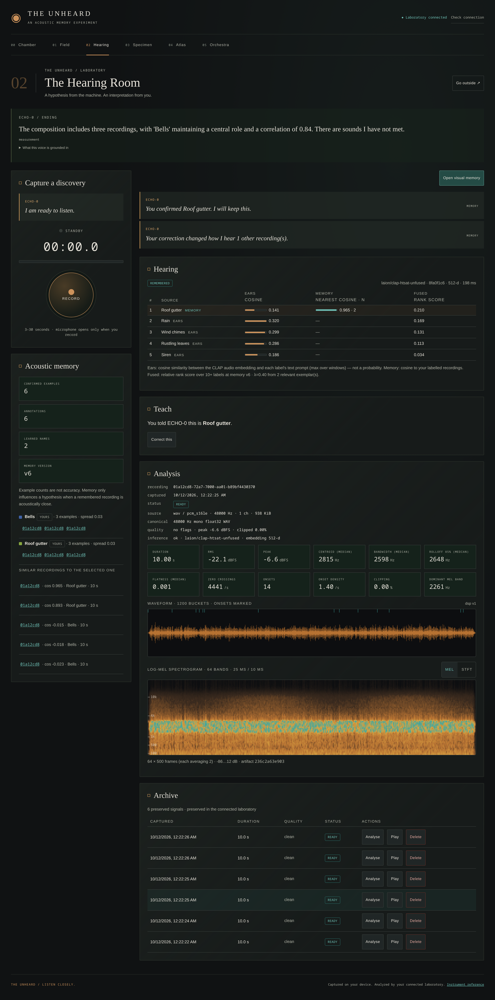
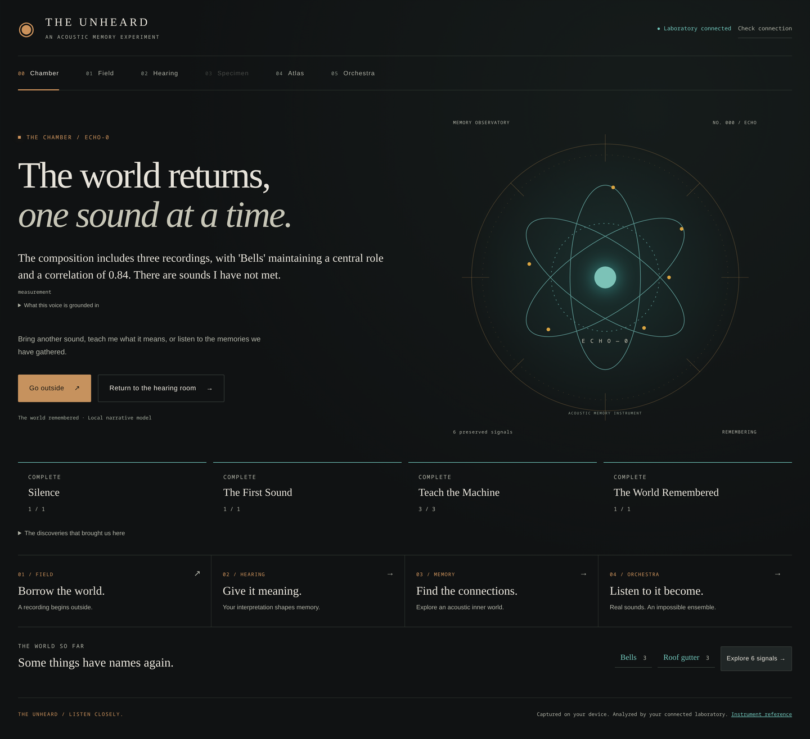
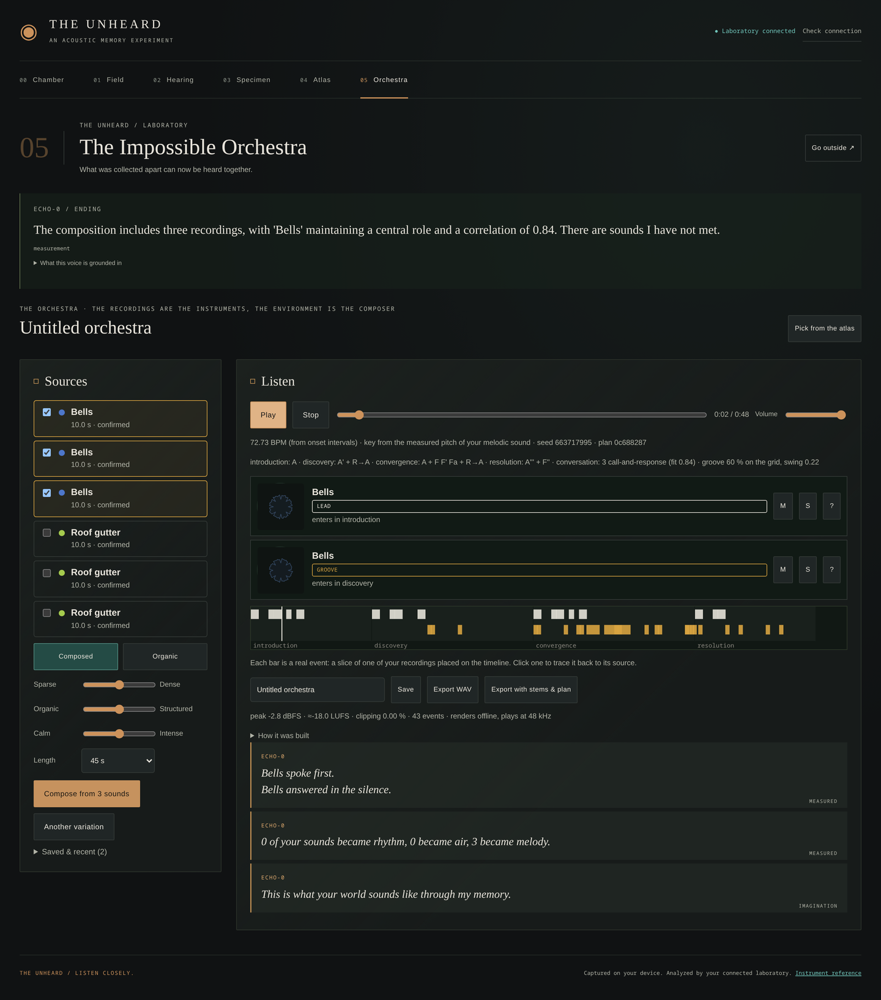
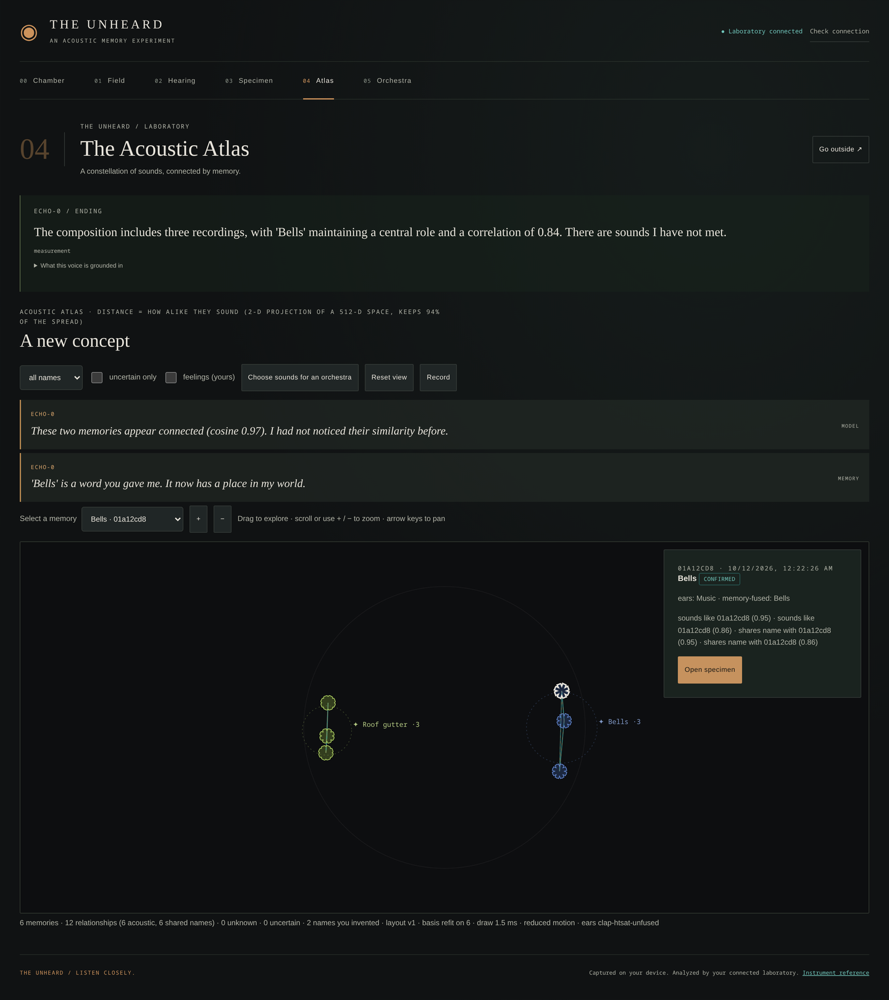
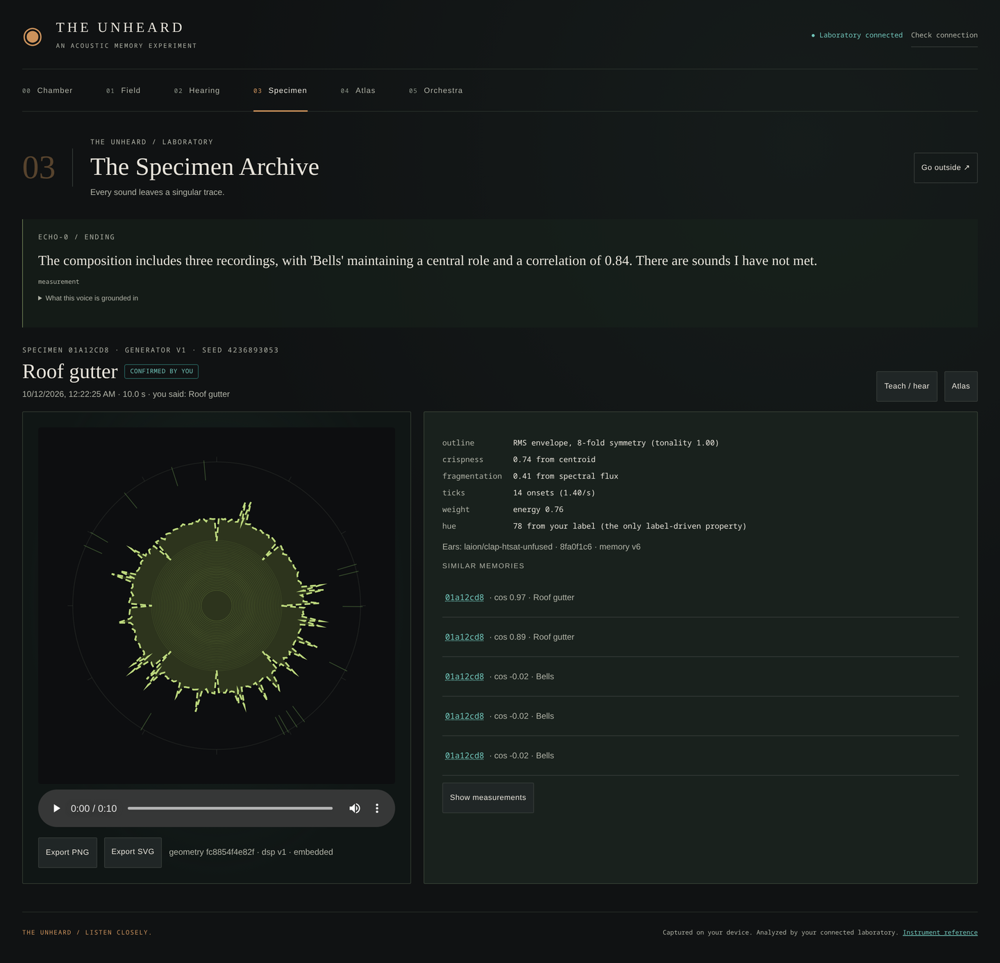

# THE UNHEARD

*An orchestra made of a world you almost forgot to hear.*

ECHO-0 knows the world’s names but has lost its acoustic memory. Go outside, collect a sound,
return to the laboratory, teach it what you heard, and listen as your memories become a composition.
A local-first React PWA, FastAPI, SQLite, CPU LAION-CLAP and local Gemma through Ollama power the experience.

## Release

`main` contains the complete project: the M5 narrative backend, the cinematic UI, the M5.5 integration and the M6
final validation (the pre-inference teaching race is fixed, HTTPS can be served by the backend itself, review
tooling and submission drafts; see [`docs/M6-FINAL-REPORT.md`](docs/M6-FINAL-REPORT.md)). M7 adds a publishable
synthetic audio set so the project can demonstrate itself without ESC-50
([`docs/M7-SYNTHETIC-AUDIO.md`](docs/M7-SYNTHETIC-AUDIO.md)).
The six scenes are **Chamber → Field → Hearing → Specimen → Atlas → Orchestra**.
Recording, classification, annotation, retrieval memory, measured visual artifacts, composition,
playback and grounded narration operate together. See the [integration report](docs/M5-5-INTEGRATION-REPORT.md),
[release checklist](docs/RELEASE-CHECKLIST.md) and [demo plan](docs/DEMO-RECORDING-PLAN.md).
Physical Android/outdoor testing and human musical/narrative review remain open
([Android checklist](docs/ANDROID-FIELD-TEST.md), [human review](docs/HUMAN-REVIEW.md)).

## What it looks like

[](docs/m7-review/05-hearing-desktop.png)

*The Hearing Room on a clip that was never taught. CLAP's own ears rank "Rain" above "Roof gutter" (cosine 0.320
against 0.141), yet the taught name comes first, because two remembered exemplars sit at cosine 0.965. Scores,
not probabilities.*

| | |
|---|---|
| [](docs/m7-review/01-chamber-desktop.png) | [](docs/m7-review/11-orchestra-desktop.png) |
| **Chamber** — ECHO-0's entrance | **Orchestra** — a Composed render from three taught sources |
| [](docs/m7-review/09-atlas-desktop.png) | [](docs/m7-review/07-specimen-desktop.png) |
| **Atlas** — real embedding similarities | **Specimen** — the measured acoustic signature |

Mobile Field Mode at 390 x 844, and the full set of thirteen frames with what to look at in each, are in
[`docs/m7-review/`](docs/m7-review/). Those are **emulated viewports, not a physical phone**, and the audio is the
synthetic set, not field recordings.

## Install

Requirements: Python **3.12** through [uv](https://docs.astral.sh/uv/), Node **22.13+ on 22.x or 24+**,
npm, FFmpeg/FFprobe, and optionally [Ollama](https://ollama.com) and mkcert.
On a shared 15 GB laptop, use CPU CLAP, `gemma3:4b`, and one backend process; avoid unnecessary model residency.

```bash
git clone https://github.com/miclaldogan/the-unheard
cd the-unheard
python3 scripts/verify_env.py
cd server
uv sync --extra ml
uv run unheard fetch-model       # explicit one-time CLAP weight download
cd ../web
npm ci
```

CLAP is `laion/clap-htsat-unfused`, a 512-dimensional embedding model. Its real cosine similarities
and personalized retrieval scores are shown as scores, not probabilities. Runtime downloads are off;
[model setup](docs/model-setup.md) explains preprocessing, cached weights and model limitations.
Personal learning is retrieval over your annotations; neither model is fine-tuned.

For the optional local narrator, start Ollama using your platform’s normal service setup and run:

```bash
ollama pull gemma3:4b             # about 3.3 GB, subject to Gemma Terms of Use
ollama list
```

Gemma receives short factual packets. The backend computes progression and missions, checks every
line, and serves a deterministic template immediately while generation runs. Unavailable, timed-out
or rejected generation falls back to those facts. [Narrative design](docs/gemma-narrative-engine.md)
and [contract m5.1](docs/contracts/M5-NARRATIVE-API.md) describe this boundary.

## Run

```bash
# Terminal 1: loopback API, persistent data in server/data/
cd server
UNHEARD_DEVICE=cpu UNHEARD_TORCH_THREADS=2 UNHEARD_NARRATIVE_MODEL=gemma3:4b uv run unheard serve
# Terminal 2: UI with same-origin /api proxy
cd web
npm run dev
```

Open `http://localhost:5173`. API documentation is `http://127.0.0.1:8000/api/docs`.
For the production PWA: `cd web && npm run build`, then run `unheard serve` from `server/`;
FastAPI serves `web/dist` at `http://127.0.0.1:8000`. The service worker is production-only.

Useful settings: `UNHEARD_DATA_DIR` for a separate profile, `UNHEARD_API_TOKEN` for bearer authentication,
`UNHEARD_MODEL_NAME=none` for DSP-only operation, `UNHEARD_NARRATIVE_GEMMA=false` for template-only
narration, and `UNHEARD_NARRATIVE_RUNTIME_URL` for your local Ollama URL. Full settings are in
[config.py](server/unheard/config.py). The CLI reads `UNHEARD_MODEL_NAME`, not `UNHEARD_MODEL`.
For a non-default development backend, set `UNHEARD_BACKEND=http://127.0.0.1:<port>` when starting Vite.

## Mobile Field Mode and privacy

Phone microphone access needs trusted **HTTPS**. Follow [local HTTPS](docs/local-https.md): trust your
local CA on the phone, configure `UNHEARD_API_TOKEN`, and either use Vite’s HTTPS proxy (development) or serve the
production build directly with `unheard serve --lan --ssl-certfile … --ssl-keyfile …`. Pair once with `?token=...`; treat that URL as private. Do not expose the
laptop or recordings publicly to obtain HTTPS. The phone uses the same backend; it is not a cloud app.

Field capture saves original bytes in IndexedDB before upload, bounded to **64 MiB / 100 recordings**.
Upload is explicit; requested uploads retry while the app is open after reconnection, with bounded
backoff and manual recovery. A lost acknowledgement reuses the backend’s content deduplication.
Local copies remain until you delete them. Download important originals: browser storage can be cleared
or evicted. Storage failure leaves a downloadable in-memory preview; leaving the page can lose it.

The PWA caches its shell, **not private API responses or audio**. Offline capture is supported;
AI inference and composition need the connected laptop. Recording is explicit and visible.
Keep the screen awake: browsers can suspend recording on lock or backgrounding. No guaranteed
background recording or Background Sync is claimed. Close all app tabs after stopping capture/playback
to let a waiting shell update activate. No Android APK is supplied.

## Play the journey

1. **Chamber:** meet ECHO-0 and see its real progression and grounded voice.
2. **Field:** Record, Stop, preview, save locally, then Submit for analysis when connected.
3. **Hearing:** inspect the waveform/spectrogram and CLAP hypotheses. Confirm, correct, name or mark
   a sound unknown; annotations and correction history persist. Subjective notes stay separate from labels.
4. **Specimen:** play the original and explore/export its deterministic measured acoustic signature.
5. **Atlas:** explore real embedding similarities and label anchors with pan, zoom, filters and selection.
6. **Orchestra:** select sounds, choose **Organic** (source-timed atmospheric structure) or **Composed**
   (motifs, phrases, sections and call-and-response), render, play, seek, mute/solo, compare sources and export WAV.
   Playback continues between compatible scenes; specimens react to actual timeline activity.

The ending requires a ready composition made from at least three annotated recordings. It comes from
persisted backend state. Human listening has not established whether the refined compositions are better.
Available local comparisons and the Gemma evaluation sheet are described in the release checklist.

## Demo audio without ESC-50

ESC-50 is private evaluation material and must not appear in a public demo or in Git, which left nothing the
project was allowed to show. `scripts/m7_synthetic_sounds.py` synthesises a six-clip set from scratch — rain in a
metal gutter and a tolling bell, three takes each — so the audio carries this repository's own licence and is free
to publish. The clips are not committed; the generator is seeded, so any clone reproduces identical files.

```bash
python scripts/m7_synthetic_sounds.py generate    # six WAVs + manifest into server/data/m7_synthetic/
python scripts/m7_synthetic_sounds.py verify      # through the backend's own sniffer, decoder and validator
python scripts/m7_synthetic_sounds.py describe    # what each clip is for

# full journey on a disposable profile
rm -rf /tmp/unheard-m7
UNHEARD_DATA_DIR=/tmp/unheard-m7 uv run --extra ml unheard serve --port 8011
UNHEARD_REVIEW_URL=http://127.0.0.1:8011 python scripts/m7_synthetic_journey.py
```

The journey teaches two gutter clips a name CLAP has never heard and holds the third out. On the held-out clip the
taught label moves from absent to **rank 1** with two exemplars and `evidence: memory`, which is the retrieval
mechanism working end to end; the three bells then supply the Composed renderer with its three taught sources and
the ending unlocks. These are synthesised signals, **not field recordings**, and every upload is stamped
`synthetic: true` so it stays distinguishable in the database. Measurements, the droplet-density finding and the
claim limits are in [`docs/M7-SYNTHETIC-AUDIO.md`](docs/M7-SYNTHETIC-AUDIO.md).

## Reproducible tests

```bash
cd server
uv run pytest
uv run ruff check .
uv run ruff format --check .
uv run mypy unheard
uv run python ../scripts/m5_export_schemas.py --check
# Sequential real-model checks; require cached CLAP / local ESC-50 evaluation clips and Ollama:
UNHEARD_TORCH_THREADS=2 uv run --extra ml pytest -m real_model tests/test_real_model.py -s
uv run pytest -m real_gemma tests/test_narrative_real_gemma.py -s
cd ../web
npm run lint
npm run typecheck
npm test
npm run format:check
npm run build
```

The default backend suite uses isolated model doubles; the real-model commands are separate gates.
[Browser review scripts](web/scripts/) need Playwright Core and sandbox-capable Chrome; use only a disposable
backend profile because they create recordings and compositions. [Manual checks](docs/UI-MANUAL-TEST-CHECKLIST.md)
cover physical devices and artistic review. Actual integrated results and screenshots are in the M5.5 report.

## Limits and licensing

The backend is a single-process local monolith with SQLite WAL and an in-process job worker.
The archive currently requests the first 100 records; deep links and large-library stress validation remain open.
Novelty detection is a heuristic, not a calibrated guarantee. Visual geometry maps measured acoustics artistically;
Atlas is a stable 2-D view of a high-dimensional space. No location is collected by Field Mode.

Project code: [MIT](LICENSE). CLAP’s model card lists Apache-2.0; Gemma has its own Terms of Use.
Weights are downloaded locally and never redistributed here. ESC-50 clips used for local evaluation are
**not demonstration assets**: individual source licensing must be checked before any publication. Use the
synthetic M7 set for anything public.
No personal recordings, model weights, database files or credentials belong in Git.
