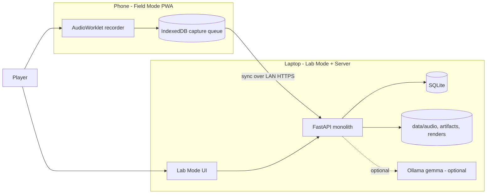
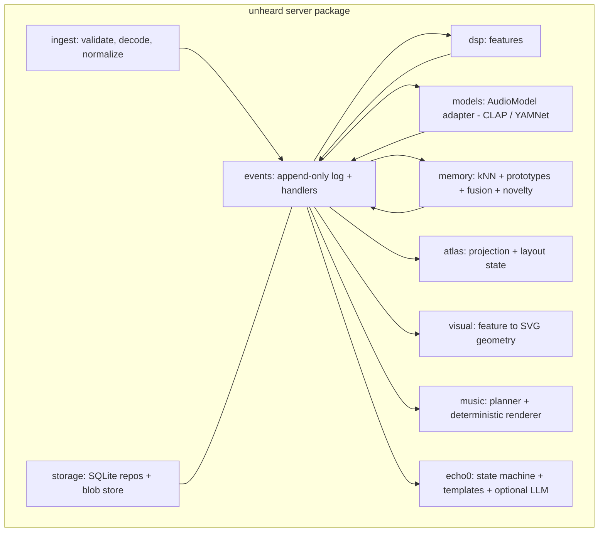
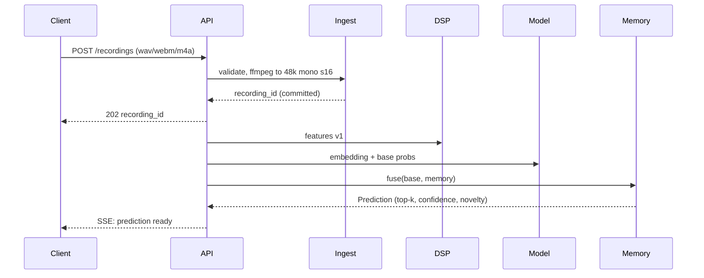
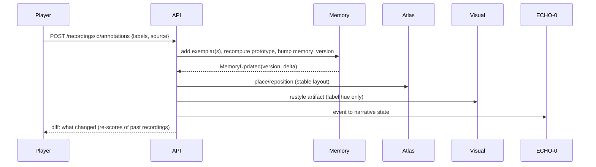
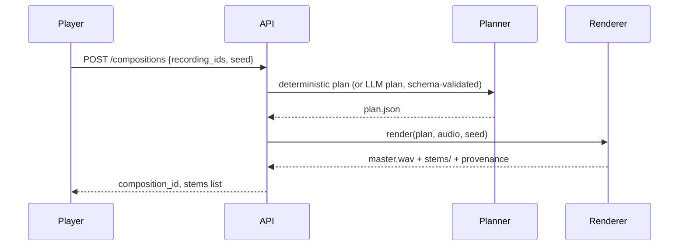

# 02 — System Architecture

**Style: modular monolith.** One Python process (FastAPI) with internal packages having explicit interfaces; one React PWA; SQLite + filesystem. No queues, vector DB, or microservices (ADR-003).

## System context


## Components

Boundary rule: modules talk only through (a) typed function interfaces in `contracts/` and (b) events. No module imports another's internals.

## Core event chain
`RecordingCaptured → FeaturesExtracted → PredictionGenerated → HumanAnnotationSubmitted → MemoryUpdated → AtlasUpdated → CompositionUpdated`

Implemented as an **in-process synchronous pipeline with a persisted event log and job table**; handlers run in a single worker thread (inference is the bottleneck, not I/O).

### Guarantees
- **Durability first:** the raw WAV and `recording` row are committed *before* any processing. Inference failure leaves `processing_job.status='failed'` with error; the recording and any later label survive.
- **Idempotency:** each event has `event_id` (UUIDv7) and handlers key on `(recording_id, stage, algo_version)`; reruns upsert. Upload dedupes on SHA-256 of normalized PCM (`recording.content_hash` UNIQUE per install).
- **Retries:** up to 3, exponential backoff, only for stages flagged retryable (model load OOM yes, corrupt file no).
- **Consistency:** each handler writes its outputs + next event row in one SQLite transaction (transactional outbox). At-least-once delivery, idempotent handlers → effectively once.
- **Human labels never depend on inference:** `HumanAnnotationSubmitted` is accepted even if predictions are missing; memory update needs only the embedding, which is re-queued if absent.

## Sequence: audio processing


## Sequence: learning feedback


## Sequence: music


## Deployment topology
Primary: laptop runs server bound to LAN with HTTPS (mkcert cert, because `getUserMedia` needs a secure context). Phone installs PWA, records offline, syncs when on the same network. Alternative: a temporary quick tunnel for demos (a remote relay — UI must label it as such). Raw audio goes to the laptop only. True offline *inference* on the phone is **not** an MVP claim: phone = offline capture, laptop = inference.

## Repository layout (to be created in M1)
```
the-unheard/
  server/unheard/{ingest,dsp,models,memory,atlas,visual,music,echo0,events,storage,api}/
  server/tests/  server/pyproject.toml
  web/ (Vite + React + TS) src/{field,lab,components,state}/
  contracts/ (JSON Schema: events, composition plan, API)
  eval/ (datasets README, run_eval.py, reports/)
  scripts/ (verify_env.py, fetch_models.py, mkcert.sh)
  docs/architecture/
  data/ (gitignored)
```

## Container diagram note
Single deployable: `uv run unheard serve` serves API and the built `web/dist`.
