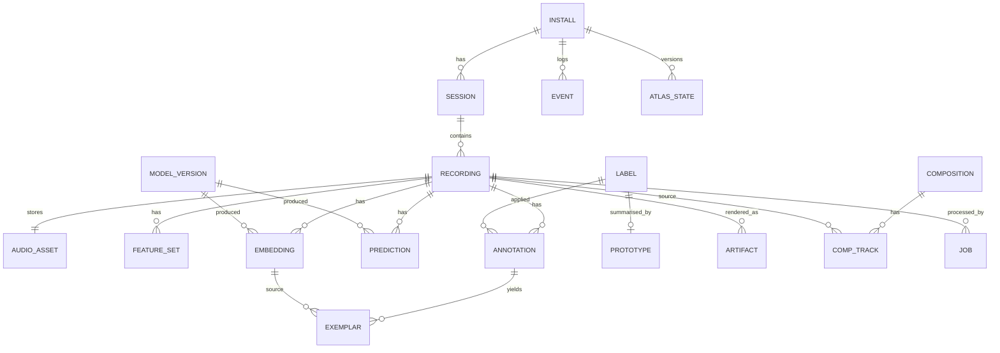

# 08 — Data Model and Contracts

## Storage decision
**SQLite (WAL) + content-addressed files on disk** server-side; **IndexedDB** on the phone only as an offline capture queue (blobs + metadata) — it is a transit buffer, not a source of truth. Embeddings are stored as float32 BLOBs (512-d ≈ 2 KB); kNN is brute force over a few thousand rows in numpy — a vector DB is unjustified below ~10⁵ vectors. OPFS is not used (no benefit with a local server). Migrations: numbered SQL files, `PRAGMA user_version`.

## ERD


## Tables (PK = UUIDv7 text unless noted)
| Table | Key columns |
|---|---|
| install | id, created_at, schema_version |
| session | id, install_id, started_at, place_note (free text, optional), coarse_geo (nullable, user-approved ≈1 km) |
| recording | id, session_id, content_hash UNIQUE, duration_s, captured_at, device_info, quality_json, deleted_at |
| audio_asset | recording_id PK, path, sample_rate, channels, bytes, original_mime |
| feature_set | id, recording_id, dsp_version, json, UNIQUE(recording_id,dsp_version) |
| model_version | id, name, revision, license_note, sha256 |
| embedding | id, recording_id, window_idx, model_version_id, vec BLOB, UNIQUE(recording,window,model) |
| prediction | id, recording_id, model_version_id, memory_version, base_json, fused_json, novel BOOL, created_at |
| label | id, name, created_at, merged_into NULL, hue_seed |
| annotation | id, recording_id, label_id, source (`user`/`confirm`/`correct`), superseded_by NULL, created_at |
| exemplar | id, annotation_id, embedding_id, weight, status |
| prototype | label_id PK, vec BLOB, n_eff, sigma, memory_version |
| artifact | id, recording_id, kind (`fragment_svg`), visual_version, geometry_hash, path |
| atlas_state | version PK, basis BLOB, positions_json, created_at |
| composition | id, seed, plan_json, planner (`det`/`llm`), render_version, master_path, master_sha256, created_at |
| comp_track | id, composition_id, recording_id, role, stem_path |
| event | id, type, payload_json, recording_id NULL, created_at (append-only) |
| job | id, recording_id, stage, status, attempts, error, updated_at |
| narrative_state | key PK, value_json (derived cache; rebuildable from event) |

## Ownership, retention, deletion
Data belongs to the install; nothing leaves the machine unless the user exports. **Delete recording** = remove audio file + features + embeddings + artifacts, retract exemplars, recompute prototypes/atlas, tombstone the `recording` row (id + hash only, to block silent re-import; user can purge tombstones). Compositions that used it are marked `stale` (still playable from their stored render unless the user deletes them too; UI says so). Export = zip of SQLite + files; import validates `schema_version`.

## API (REST + SSE)
| Method | Path | Body → Response |
|---|---|---|
| POST | /api/recordings | multipart audio + `{captured_at, session_id?, device_info}` → 202 `{recording_id, status}` ; 409 duplicate returns existing id |
| GET | /api/recordings/{id} | recording + features + latest prediction + artifact URL |
| GET | /api/recordings/{id}/audio | WAV |
| POST | /api/recordings/{id}/annotations | `{labels:[{label_id|new_name}], action:confirm|correct|create}` → `{memory_version, delta}` |
| DELETE | /api/recordings/{id} | 204 |
| GET | /api/labels · POST /api/labels/{id}/merge | |
| GET | /api/atlas | `{version, nodes, edges, anchors}` |
| POST | /api/compositions | `{recording_ids, seed?, planner?}` → 202 |
| GET | /api/compositions/{id}[/master|/stems/{n}|/export] | |
| GET | /api/echo0/state · /api/echo0/next | state, next utterance with provenance tags |
| GET | /api/events/stream | SSE of events |
| GET | /api/health | model loaded, versions, free disk |
Errors: RFC 7807 `application/problem+json` with stable `code` (`AUDIO_TOO_SHORT`, `AUDIO_UNDECODABLE`, `MODEL_UNAVAILABLE`, `PLAN_INVALID`, …). Upload cap 25 MB.

## Event envelope
```json
{"event_id":"…","type":"PredictionGenerated","version":1,"occurred_at":"…","install_id":"…","recording_id":"…",
 "payload":{"model_version_id":"…","memory_version":4,"top":[{"label":"bird","p":0.62}],"novel":false}}
```
Types: RecordingCaptured, RecordingRejected, FeaturesExtracted, EmbeddingComputed, PredictionGenerated, HumanAnnotationSubmitted, MemoryUpdated, LabelCreated, LabelMerged, RecordingDeleted, AtlasUpdated, ArtifactRendered, CompositionRequested, CompositionUpdated, JobFailed.

## Background jobs
In-process worker thread + `job` table polled at 250 ms; one job at a time (model memory). On restart, `running` jobs are reset to `queued`.
