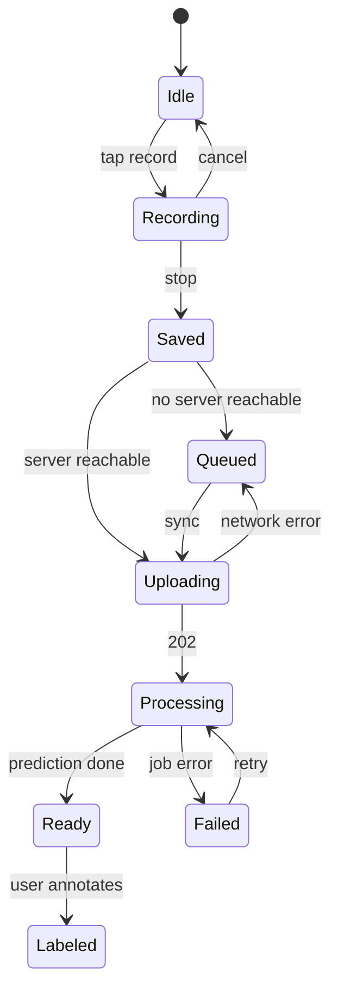

# 09 — UX and Interaction Design

## Visual identity (own, not derived from other projects)
Graphite `#121315` ground · aged copper `#B87333` primary · muted amber `#D9A441` warnings/uncertainty · restrained teal `#3FA7A0` signal/active · text `#E7E3DA` (contrast ≥ 7:1 on ground). Type: a slab/mono pair (e.g. IBM Plex Mono + Source Serif 4) in a "field-notebook / instrument log" style; faint grain overlay (CSS, disabled under `prefers-reduced-motion`). Light theme is not required for MVP; contrast is checked.

## Two modes, one state
Both are routes of the same PWA backed by the same server state (`/api/*`). Phone and laptop share state by talking to the same server; the phone holds only the unsynced capture queue.

### Field Mode (phone, `/field`)
Screen inventory: (1) Ready — one huge Record button, session note field optional; (2) Recording — big timer, level meter, Stop; haptic on stop; (3) Saved — "queued / synced" chip, ECHO-0 one-line quest; (4) Queue — list with sync state. Everything else lives in Lab.
Rules: ≤ 2 taps to record; target 44 px+ hit areas (we use ≥ 72 px for Record); screen may dim during recording (Wake Lock released on stop; **user chooses** whether to keep the screen awake — default off to save battery, with a warning that some browsers stop capture when locked [M]); no maps, no location tasks. Permission pre-explainer before the mic prompt. Offline: recording works with no network; sync button + auto-retry when the server host is reachable.

### Lab Mode (desktop, `/lab`)
Screens: **Inbox** (new recordings + pending question), **Recording detail** (waveform, log-mel spectrogram, features, predictions with provenance chips, label form), **Memory** (labels, prototypes, exemplars, "why did you guess this?" neighbours), **Atlas**, **Orchestra** (select recordings, seed, render, per-stem solo/mute, export), **ECHO-0 log**, **Settings/Privacy** (delete, export, model status).
Navigation: left rail with act-progress; responsive collapse to bottom tabs <768 px.

## State diagram — recording

## Core flow (lab)
Record → Inbox shows card with artifact + top-k → ECHO-0 asks one question (confirm/choose/name new) → diff panel ("what changed": memory version, re-scored recordings, atlas move) → Orchestra unlock → render → listen original/stems/master.

## Accessibility
Labels on all controls; keyboard-operable Lab; waveform/spectrogram have text summaries (duration, peak, dominant band); status not conveyed by colour alone; reduced-motion honored.

## Minimising screen time
No feed, no streaks, no notifications. Quests are phrased as "go listen for 10 minutes"; the app is closed between recordings. The post measures it: log screen-on seconds per field session in the evaluation protocol (doc 11).
